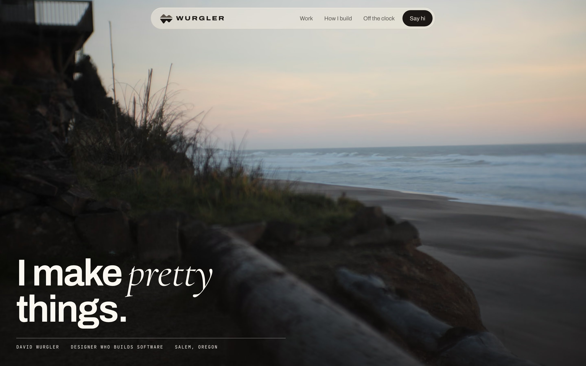
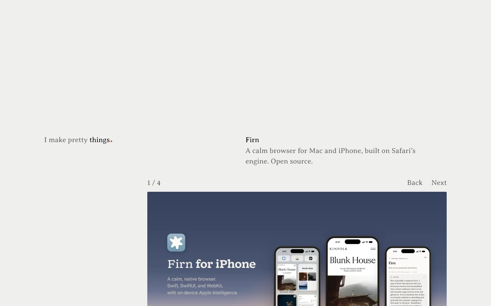

<p>
  <picture>
    <source media="(prefers-color-scheme: dark)" srcset="public/brand/wurgler-mark-bone.svg">
    
  </picture>
</p>

The personal site of David Wurgler, a designer who builds software.

**[davidwurgler.com](https://davidwurgler.com)**



## The idea

One sentence on an empty page. Each word is a door, and the full stop is how you say hi.



## How it was made

I don't write most of the code. I write the brief.

Every project starts with a document: who it's for, the rules the agent can't break, and a done test for each step. Then I direct Claude Code through it in pieces small enough to check. I decide what the site is and how it should feel. Claude and I write the code together and catch each other's mistakes.

This site was built that way, and the documents are all here:

- [`CLAUDE.md`](CLAUDE.md): the brief. What the site is for, the design rules, the facts it may use, and how to work with me.
- [`docs/HISTORY.md`](docs/HISTORY.md): what changed and why, including the site this one replaced.
- [`design/brand-kit/`](design/brand-kit/): the brand guide, tokens, and reference screenshots.

## The design

- **One typeface, one size, one weight:** Averia Serif Libre Light, for everything. What matters is black; what doesn't is grey.
- **Two tones and one dot.** The only colour on the site is the red dot.
- **Emptiness is the material.** More empty space than feels correct.
- **Words before pictures.** Pictures appear only after you ask to see a thing, and then they're big.

| | Light | Dark |
|---|---|---|
| Ground | `#eff0ee` | `#0e0f10` |
| Text | `#0e0f10` | `#e9eae7` |
| Grey | `#696b6a` | `#8e908e` |
| The dot | `#e5482d` | `#f0573b` |

The mark is an uneven Cascade ridge over a waterline, with a longer reflection below that forms a W. The full design rules are in [`CLAUDE.md`](CLAUDE.md).

## Built with

- [Astro](https://astro.build), as a static site. Every page works without scripts.
- A self-hosted font from [Fontsource](https://fontsource.org): Averia Serif Libre, by Dan Sayers, under the SIL Open Font License.
- Cloudflare for hosting, and Cloudflare Web Analytics, which is cookieless.

No cookies, no trackers, and no third-party scripts.

To run it locally:

```bash
npm install
```

```bash
npm run dev
```

## Rights

All rights reserved. You're welcome to read the code and learn from it. The photographs, music, writing, and brand (the Wurgler mark) are mine and may not be reused. The font is its author's, under its own licence.

© 2026 David Wurgler
