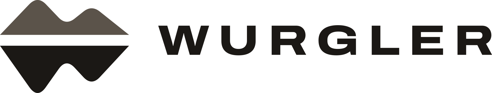
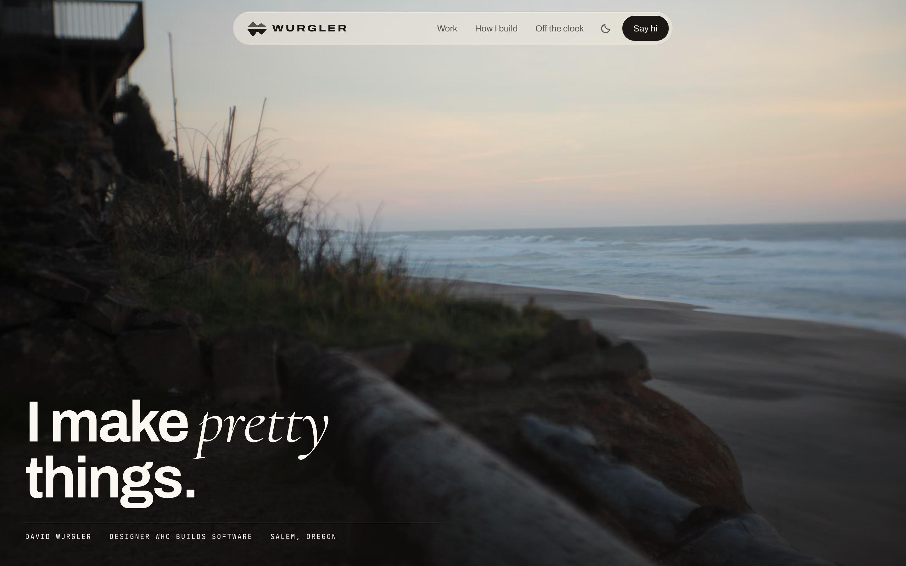
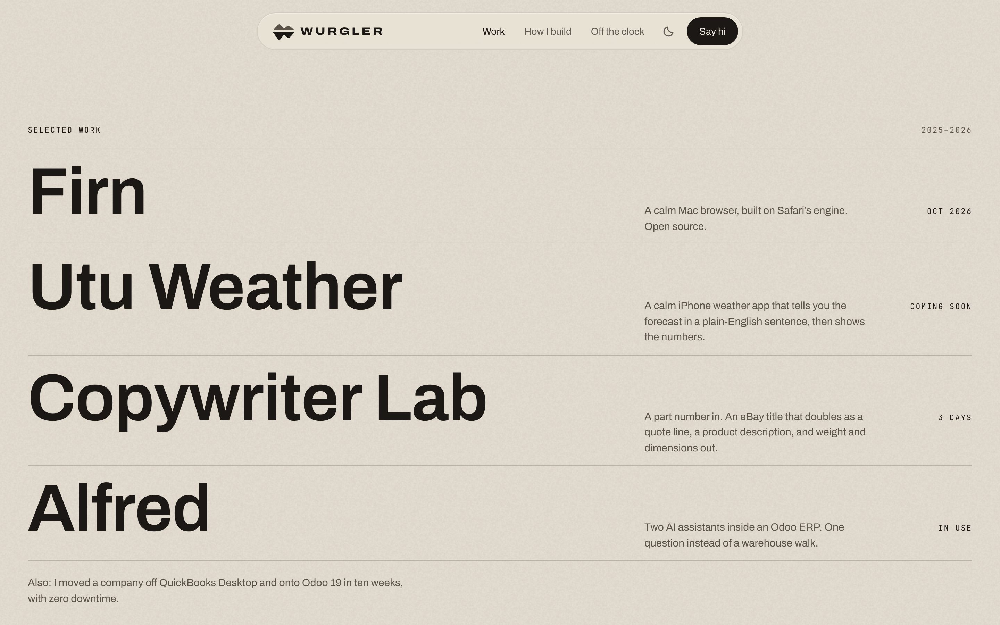

<p>
  <picture>
    <source media="(prefers-color-scheme: dark)" srcset="public/brand/wurgler-lockup-bone.svg">
    
  </picture>
</p>

The personal site of David Wurgler, a designer who builds software.

**[davidwurgler.com](https://davidwurgler.com)**



## How it was made

I don't write most of the code. I write the brief.

Every project starts with a document: who it's for, the rules the agent can't break, and a done test for each step. Then I direct Claude Code through it in pieces small enough to check. I decide what the site is and how it should feel. Claude and I write the code together and catch each other's mistakes.

This site was built that way, and the documents are all here:

- [`CLAUDE.md`](CLAUDE.md): the brief. What the site is for, the design rules, the facts it may use, and how to work with me.
- [`docs/PLAN.md`](docs/PLAN.md): the plan, one phase and one checkbox at a time.
- [`docs/HISTORY.md`](docs/HISTORY.md): what changed and why.
- [`design/mockup-v5.html`](design/mockup-v5.html): the approved homepage design.

## The design

Warm paper with ink type, and my own photographs as windows in it. Calm, tactile, and quick.



| | Light | Dark |
|---|---|---|
| Ground | `#ece6dc` paper | `#171512` night |
| Text | `#1b1815` ink | `#f0eae1` bone |
| Muted | `#5b534a` | `#a39a8e` |

There's no accent colour. Colour comes from the photos.

- **Type:** Archivo for almost everything, Cormorant Garamond Italic for one emphasised word per screen, and JetBrains Mono for small labels.
- **Materials:** a fine paper grain, and glass only on the control bar and buttons over photos.
- **Motion follows your hand.** Scroll and the cursor drive almost every movement. Nothing makes you wait.
- **Real over decorative.** Texture comes from real photographs and real screenshots, never from effects that imitate film.

The mark is an uneven Cascade ridge over a waterline, with a longer reflection below that forms a W. The brand files are in [`public/brand/`](public/brand/). The full design rules are in [`CLAUDE.md`](CLAUDE.md).

## Built with

- [Astro](https://astro.build), as a static site
- Self-hosted fonts from [Fontsource](https://fontsource.org)
- Cloudflare for hosting, and Cloudflare Web Analytics, which is cookieless

No cookies, no trackers, and no third-party scripts.

To run it locally:

```bash
npm install
```

```bash
npm run dev
```

## Rights

All rights reserved. You're welcome to read the code and learn from it. The photographs, music, writing, and brand (the Wurgler mark, wordmark, and lockups) are mine and may not be reused.

© 2026 David Wurgler
